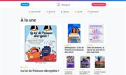
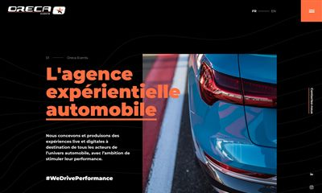

  

  
  
  

> Huit ans de front-end en React et TypeScript, dont trois comme référent front-end. Mon terrain : des applications que les équipes peuvent faire évoluer sans casse — design system, revue de code, tests end-to-end.

## 🚀 Réalisations

<table>
<tr>
<td align="center" valign="top">
  
   <b>RRG</b>
</td>
</tr>
<tr>
<td align="center" valign="top">
  <table width="100%"><tr>
  <td align="center" width="25%"> <b>SPK</b></td>
  <td align="center" width="25%"> <b>Datagora</b></td>
  <td align="center" width="25%"> <b>Radio Guira</b></td>
  <td align="center" width="25%"> <b>Oreca Experience</b></td>
  </tr></table>
</td>
</tr>
</table>

## 🛠️ Mes dépôts test

<table>
<tr>
<td align="center" width="50%" valign="top">
  
   
  <b>Laboratoire machine learning</b>
   
  <a href="https://github.com/kewinMarchand/tensor-lab" title="Dépôt">📦</a>
  &nbsp;
  <a href="https://kewinmarchand.github.io/tensor-lab/" title="Démo">🌐</a>
</td>
<td align="center" width="50%" valign="top">
  
   
  <b>Pause café</b>
   
  <a href="https://github.com/kewinMarchand/neon-games" title="Dépôt">📦</a>
  &nbsp;
  <a href="https://kewinmarchand.github.io/neon-games/" title="Démo">🌐</a>
</td>
</tr>
</table>

### Détail des réalisations

### 🚗 Plateforme e-commerce automobile à fort trafic
*Retail Renault Group (RRG), réseau multi-concessions*

**Auteur principal de la refonte**, de l'ancienne application Angular à Next.js. Refonte complète : domaines indépendants, design system, rendu serveur, tunnel d’achat, SEO, accessibilité, scénarios e2e, Core Web Vitals.
Des domaines indépendants, un design system d'une quarantaine de composants, un thème multi-marques, plus de deux cents scénarios end-to-end. Plus de 6 500 heures sur les sites du groupe depuis 2018.

`Next.js` `React` `TypeScript` `Redux Toolkit` `TanStack Query` `MUI` `CodeceptJS`

### 🛍️ Portails de commande B2B
*Sur Djust · distribution professionnelle et grande consommation*

Sur la solution B2B Djust : **une dizaine de déclinaisons clientes d’une même base**, avec catalogues, comptes multi-acheteurs, circuits de commande et back-offices. Front en Nuxt 2 et TypeScript, composants documentés dans Storybook. Plus de 850 heures sur ces portails depuis 2022.

`Nuxt 2` `TypeScript` `Storybook`

### 📦 Refonte du site DHL Express France
*DHL Express, transport express international*

Refonte graphique complète du front, site maintenu dans la durée et audité au regard du RGAA. Plan de mesure GA4 et son contrôle qualité.

`Symfony` `Laravel` `JavaScript` `GA4`

**Autres réalisations**

- **Datagora** : média de vulgarisation statistique, site web et application mobile sur le Play Store. `React` `React Native`
- **Radio Guira** : site radio (Symfony, SPA React, lecteur audio, RGAA). `Symfony` `React` `TypeScript`
- **Oreca Experience** : sites d'Oreca Events et du Driving Center, pages produit Alpine animées au défilement. `Next.js` `Framer Motion`
- **Audits d'accessibilité RGAA 4.1** : Monext, solutions de paiement (taux de conformité mesuré, non-conformités relevées, plan de remédiation chiffré en jours, puis mise en conformité) et trois audits plus ciblés. `RGAA 4.1` `WCAG 2.1 AA`
- **Datagora**, média de vulgarisation statistique : site web et application mobile publiée sur le Play Store. `React` `React Native`
- **E-commerce de pièces auto et moto** (Dépamoto, Quartier des Jantes, Jantes et Pneus) : boutiques et configurateur de compatibilité véhicule, maintenu plusieurs années. `Symfony` `Twig` `Vue.js`
- **Applications métier** : plateforme de recrutement Jobs by RRG, application tablette d'audits terrain pour Montaclair, utilisable hors ligne. `Vue.js` `Twig`
- **Une vingtaine de sites vitrines et institutionnels**, plusieurs multilingues. `React` `Next.js` `Vue.js` `Svelte` `WordPress`

<b>🧭 Ce que j'apporte</b>

&nbsp;

| 🧱 Construire | ✅ Fiabiliser |
|---|---|
| Applications React, Next.js et TypeScript en `strict`, découpées en domaines, avec un design system qui isole l'application des librairies tierces. | Revue de code des développeurs internes et prestataires, décisions d'architecture front écrites, tests end-to-end desktop et mobile, Core Web Vitals et accessibilité contrôlés. |

<b>🧰 Compétences</b>

&nbsp;

| Domaine | Ce que je pratique |
|---|---|
| **Front-end** | React, Next.js (App Router, Server Components), TypeScript, Redux Toolkit, TanStack Query, Vue 3 et Nuxt, Svelte |
| **Interface** | MUI, Tailwind, Sass, Storybook, Framer Motion, intégration fidèle aux maquettes Figma |
| **Qualité** | Revue de code, tests end-to-end (CodeceptJS, Playwright), Core Web Vitals, Lighthouse, checklist de mise en production |
| **Accessibilité** | RGAA 4.1 et WCAG 2.1 AA au quotidien, audits |
| **Back consommé** | API REST, Symfony et API Platform, types générés depuis OpenAPI, Node.js |
| **Outillage** | Git, GitHub, GitLab, Docker, Sentry, GA4, Matomo |
| **IA** | Claude Code au quotidien : contexte projet versionné, agents de développement, de relecture et de recette, hooks de contrôle avant commit |

Ce que je ne fais pas : modélisation de bases de données, administration système, développement back-end.

<b>💼 Parcours</b>

&nbsp;

| Période | Poste | Structure |
|---|---|---|
| 2018 → 2026 | **Développeur front-end et référent front-end** | PURJUS Communication, agence digitale, Vauvenargues |
| 2017 → 2018 | **Formateur « Web designer »** | AFPA, Le Pontet et Salon-de-Provence |
| 2017 | **Intégrateur web** | Agence Hors Pistes, Venelles |
| 2015 → 2017 | **Infographiste paysager** | Star's Jardin (Thibaud de Beschart) |
| 2015 | Vendeur conseil jardinerie | Botanic |
| 2010 → 2013 | Ouvrier paysagiste | Les Jardins Sestian, Maniebat |
| 2005 → 2010 | Jardinier-paysagiste | Particuliers employeurs (CESU) |
| 1999 → 2005 | Apprenti paysagiste, du BEPA au BTSA | Jardin Vert, Mondouzil |

2005 : Prix de l'apprentissage Midi-Pyrénées.

<b>🎓 Formation</b>

&nbsp;

- **2017 → 2018** · Titre professionnel **Designer web**, AFPA (niveau 5)
- **2014** · **DAO — Professionnaliser sa pratique** (AutoCAD, SketchUp, SolidWorks), GRETA Occitanie
- **2003 → 2005** · BTSA Aménagement de l'espace paysager, en apprentissage

Permis B · Français (langue maternelle) · Anglais (lecture technique) · Espagnol (intermédiaire) · Passionné de botanique
