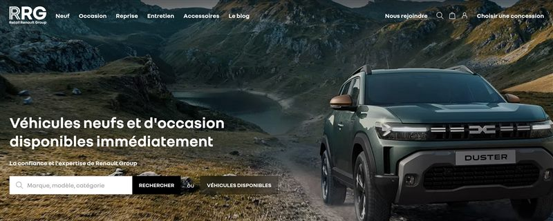

  

> Huit ans de front-end en React et TypeScript, dont trois comme référent front-end. Mon terrain : des applications que les équipes peuvent faire évoluer sans casse — design system, revue de code, tests end-to-end.

## ✦ Mes réalisations professionnelles

  

<h3 align="center">retail-renault-group.fr</h3>

  <strong>Plateforme e-commerce et de services automobile</strong> du réseau Retail Renault Group (Renault, Dacia, Alpine) : reprise d’une application Angular.js, refonte puis migration vers React/Next.js, suivies de huit années d’évolution continue. J’y ai conçu et fait vivre l’architecture front, le design system, les parcours de stock, de réservation, d’après-vente et de recrutement, en équipe avec chef de projet, product owner, graphistes interne et externe. Exigences fortes sur le SEO, le RGAA, les Core Web Vitals, la mesure (GA4, GTM, Sentry) et les tests end-to-end.

<table style="border:none;border-collapse:separate;border-spacing:12px" border="0" cellpadding="8" cellspacing="8">
<tr>
<td align="center" valign="top" style="border:none"><h3 align="center">spk-group.fr</h3>
<strong>Site vitrine bilingue d’agence</strong> (SPK, agence et médias 100&nbsp;% sport) : création complète du front Next.js connecté à un back-office Strapi, avec pages expertises, projets, recrutement et formulaires. Réalisé en lien avec le chef de projet et l’équipe créative du client, avec un soin particulier porté aux animations, au rythme éditorial et au responsive.
</td>
<td align="center" valign="top" style="border:none"><h3 align="center">datagora.fr</h3>
<strong>Site média de données publiques</strong> : développement et évolution du front du média Datagora, dédié à la mise en récit des données statistiques (rubriques, articles, pages équipe et contact). Intervention sur une base React/MUI, en coordination avec le chef de projet et les équipes éditoriales/produit, pour rendre les contenus plus lisibles et engageants.
</td>
</tr>
<tr>
<td align="center" valign="top" style="border:none"><h3 align="center">radioguira.org</h3>
<strong>Site de webradio et d’actualités</strong> pour Radio Guira (radio de la MINUSCA en République centrafricaine) : application SPA avec lecteur audio persistant, actualités, émissions et podcasts. Développé en Symfony/React/TypeScript en collaboration avec le chef de projet et les équipes de la radio, pour offrir une écoute continue et une navigation fluide.
</td>
<td align="center" valign="top" style="border:none"><h3 align="center">oreca-experiences.com</h3>
<strong>Site expérientiel premium</strong> du groupe ORECA, dédié aux expériences de pilotage au Circuit Paul Ricard : création du front Next.js avec mises en page immersives, transitions et animations soignées. Projet mené avec chef de projet et équipes créatives/client pour valoriser l’univers automobile et les offres d’événements.
</td>
</tr>
</table>

<table style="border:none;border-collapse:separate;border-spacing:12px" border="0" cellpadding="8" cellspacing="8">
<tr>
<td align="center" valign="top" style="border:none"><h3 align="center">dhlexpress.fr</h3>
<strong>Site de commande et d’expédition en ligne</strong> (DHL Express France) : refonte graphique complète des parcours de devis, d’envoi, de paiement, de suivi et de compte. Travail réalisé avec chef de projet, graphistes interne et externe, incluant des correctifs suite aux pentests, des améliorations d’accessibilité (RGAA) et le suivi de la mesure (GA4/GTM).
</td>
<td align="center" valign="top" style="border:none"><h3 align="center">aa-biomasse.com</h3>
<strong>Site vitrine industriel bilingue</strong> (AA-biomasse, convoyage et stockage de biomasse) : développement de A à Z du front SvelteKit relié à un back-office, avec présentation des solutions, réalisations, actualités et formulaires de contact. Conçu en coordination avec le chef de projet et les équipes métier du client pour mettre en valeur un catalogue technique.
</td>
<td align="center" valign="top" style="border:none"><h3 align="center">jantes-et-pneus.com</h3>
<strong>Site e-commerce de jantes et pneus</strong> : développement front de la boutique (Symfony/Twig/Vue.js), du configurateur de compatibilité véhicule aux fiches produits, packs et tunnel d’achat. Réalisé avec chef de projet, en lien avec les équipes du client — y compris les équipes commerciales et vendeuses — pour soutenir les parcours de vente et de conseil.
</td>
</tr>
<tr>
<td align="center" valign="top" style="border:none"><h3 align="center">quartierdesjantes.com</h3>
<strong>Site e-commerce de jantes et pneus</strong> : maintenance applicative et évolutions fonctionnelles sur la boutique (recherche, catalogue, panier, contenus), en coordination avec le chef de projet et les équipes du client, dont les équipes commerciales et vendeuses. Un travail de fond pour fiabiliser le catalogue et accompagner les opérations courantes.
</td>
<td align="center" valign="top" style="border:none"><h3 align="center">depamoto.com</h3>
<strong>Site e-commerce de motos et pièces d’occasion</strong> : maintenance et enrichissements du parcours d’achat (véhicules, pièces détachées, recherche, commande), en lien avec le chef de projet et les équipes du client, notamment les équipes commerciales et vendeuses. L’enjeu : garder un catalogue vivant et des parcours clairs pour des produits techniques.
</td>
<td align="center" valign="top" style="border:none"><h3 align="center">comites-feux.com</h3>
<strong>Site institutionnel associatif</strong> des comités communaux feux de forêts des Bouches-du-Rhône (AD13) : développement front de A à Z (actualités, formations, espace adhérents, documents), avec un back-office dédié. Projet conduit avec le chef de projet et les responsables associatifs pour faciliter l’information du public et la gestion des bénévoles.
</td>
</tr>
</table>

<b>📌 Détail des réalisations</b>

&nbsp;

### 🛒 Plateforme e-commerce automobile à fort trafic
*Plateforme e-commerce et de services — Retail Renault Group (RRG), réseau multi-concessions*

**Rôle** : auteur principal de la refonte front, du legacy Angular.js vers React puis Next.js, avec une présence continue sur plus de huit ans. **Équipe** : chef de projet, product owner, graphistes interne et externe, développeurs front/back et équipes métier.
**Réalisation** : structuration par domaines, design system multi-marques, rendu serveur, parcours de recherche/réservation de véhicules (VN/VO), après-vente et recrutement, outillage de mesure et d’observabilité. Plus de 200 scénarios end-to-end, forte attention portée au SEO, au RGAA, aux Core Web Vitals et aux performances. **Volume** : plus de 6&nbsp;500 heures sur les sites du groupe.

`Next.js` `React` `TypeScript` `Redux Toolkit` `TanStack Query` `MUI` `CodeceptJS`

### 🏢 Portails de commande B2B
*Plateformes e-commerce B2B — déclinaisons sur Djust pour la distribution professionnelle et la grande consommation*

**Rôle** : développeur/intégrateur front-end sur une base commune déclinée pour de nombreux clients. **Équipe** : chefs de projet, designers, équipes produit et développeurs.
**Réalisation** : adaptation de catalogues, comptes multi-acheteurs, circuits de commande et interfaces de back-office, avec composants documentés dans Storybook et montée en qualité progressive. **Volume** : plus de 850 heures sur ces portails depuis 2022.

`Nuxt 2` `TypeScript` `Storybook`

### 📦 Refonte du site DHL Express France
*Site de commande et d’expédition en ligne — DHL Express, transport express international*

**Rôle** : développeur/intégrateur front-end sur la refonte et la maintenance. **Équipe** : chef de projet, graphistes interne et externe, équipes techniques et métier côté client.
**Réalisation** : refonte graphique complète des parcours (devis, expédition, paiement, suivi, compte, points de service), correctifs à la suite d’audits de sécurité (pentests), améliorations d’accessibilité dans une démarche RGAA et mise en place/suivi du plan de mesure GA4 via GTM.

`Symfony` `Laravel` `JavaScript` `GA4`

**Autres réalisations**

- **SPK** — *Site vitrine bilingue d’agence* : création complète du front Next.js (contenus, expertises, projets, recrutement) avec animations et attention au rendu responsive. **Équipe** : chef de projet et équipe créative/client. `Next.js` `Strapi` `Animations` `RGAA` `SEO`
- **Datagora** — *Site média de données publiques* : contribution au front du média statistique (articles par rubriques, pages éditoriales) sur une base React/MUI, en lien avec les enjeux de lisibilité des données. **Équipe** : chef de projet et équipes éditoriales/produit. `React` `MUI`
- **Radio Guira** — *Site de webradio et d’actualités* : SPA Symfony/React/TypeScript avec lecteur audio persistant, actualités et émissions pour la radio de la MINUSCA en RCA. **Équipe** : chef de projet et équipes de la radio. `Symfony` `React` `TypeScript`
- **Oreca Experiences** — *Site expérientiel premium* : développement du front Next.js du site d’expériences de pilotage (Circuit Paul Ricard), avec transitions, animations et optimisation des médias. **Équipe** : chef de projet et équipes créatives/client. `Next.js` `Framer Motion`
- **aa-biomasse** — *Site vitrine industriel bilingue* : développement de A à Z du front SvelteKit (solutions, réalisations, actualités, formulaires) connecté au back-office. **Équipe** : chef de projet et équipes métier du client. `SvelteKit` `JavaScript`
- **Jantes et Pneus** — *Site e-commerce de jantes et pneus* : création et évolution du front (configurateur véhicule, listings, fiches, packs, tunnel d’achat) sur Symfony/Twig/Vue.js. **Équipe** : chef de projet et équipes du client, dont les équipes commerciales et vendeuses. `Symfony` `Twig` `Vue.js`
- **Quartier des Jantes** — *Site e-commerce de jantes et pneus* : maintenance et évolutions fonctionnelles de la boutique (catalogue, recherche, commande), en appui des opérations quotidiennes. **Équipe** : chef de projet et équipes du client, dont les équipes commerciales et vendeuses. `Symfony` `Twig` `Vue.js`
- **Dépamoto** — *Site e-commerce de motos et pièces d’occasion* : maintenance et enrichissements des parcours véhicules/pièces et du tunnel de commande. **Équipe** : chef de projet et équipes du client, dont les équipes commerciales et vendeuses. `Symfony` `Twig` `JavaScript`
- **Comités Feux (AD13)** — *Site institutionnel associatif* : développement front de A à Z (actualités, formations, espace adhérents, documents) et intégration avec l’administration. **Équipe** : chef de projet et responsables associatifs. `React` `React Admin`
- **Audits d’accessibilité RGAA 4.1** : notamment pour Monext (solutions de paiement) — mesure du taux de conformité, relevé des non-conformités, plan de remédiation chiffré puis accompagnement de la mise en conformité — ainsi que plusieurs audits ciblés. **Équipe** : chefs de projet et équipes produit/techniques des clients. `RGAA 4.1` `WCAG 2.1 AA`
- **Applications métier** : plateforme de recrutement Jobs by RRG et application tablette d’audits terrain pour Montaclair, utilisable hors ligne. **Équipe** : chefs de projet et équipes métier. `Vue.js` `Twig`
- **Sites vitrines et institutionnels** : une vingtaine de réalisations, dont plusieurs multilingues, aux périmètres et enjeux variés (présentation, acquisition, contenus éditoriaux). **Équipes** : chefs de projet, designers et équipes clients selon les projets. `React` `Next.js` `Vue.js` `Svelte` `WordPress`

## 🧪 Mes dépôts test

<table border="0" cellpadding="8" cellspacing="8">
<tr>
<td align="center" width="50%" style="border:none"><h3 align="center">Laboratoire machine learning</h3></td>
<td align="center" width="50%" style="border:none"><h3 align="center">Pause café</h3></td>
</tr>
</table>

<b>🛠️ Compétences</b>

&nbsp;

| Domaine | Ce que je pratique |
|---|---|
| **Front-end** | React, Next.js (App Router, Server Components), TypeScript, Redux Toolkit, TanStack Query, Vue 3 et Nuxt, Svelte |
| **Interface** | MUI, Tailwind, Sass, Storybook, Framer Motion, intégration fidèle aux maquettes Figma |
| **Qualité** | Revue de code, tests end-to-end (CodeceptJS, Playwright), Core Web Vitals, Lighthouse, checklist de mise en production |
| **Accessibilité** | RGAA 4.1 et WCAG 2.1 AA au quotidien, audits |
| **Back consommé** | API REST, Symfony et API Platform, types générés depuis OpenAPI, Node.js |
| **Outillage** | Git, GitHub, GitLab, Docker, Sentry, GA4, Matomo |
| **IA** | Claude Code au quotidien : contexte projet versionné, agents de développement, de relecture et de recette, hooks de contrôle avant commit |

Ce que je ne fais pas : modélisation de bases de données, administration système, développement back-end.

<b>👤 Parcours</b>

&nbsp;

<table>
<tr><th width="22%" style="white-space:nowrap">Période</th><th width="38%">Poste</th><th width="40%">Structure</th></tr>
<tr><td style="white-space:nowrap">2018 &rarr; 2026</td><td><b>Développeur front-end et référent front-end</b></td><td>PURJUS Communication, agence digitale</td></tr>
<tr><td style="white-space:nowrap">2017 &rarr; 2018</td><td><b>Formateur « Web designer »</b></td><td>AFPA</td></tr>
<tr><td style="white-space:nowrap">2017</td><td><b>Intégrateur web</b></td><td>Agence Hors Pistes</td></tr>
<tr><td style="white-space:nowrap">2015 &rarr; 2017</td><td><b>Infographiste paysager</b></td><td>Star's Jardin, Thibaud de Beschart</td></tr>
<tr><td style="white-space:nowrap">2015</td><td>Vendeur conseil jardinerie</td><td>Botanic</td></tr>
<tr><td style="white-space:nowrap">2010 &rarr; 2013</td><td>Ouvrier paysagiste</td><td>Les Jardins Sestian</td></tr>
<tr><td style="white-space:nowrap">2005 &rarr; 2010</td><td>Jardinier-paysagiste</td><td>Particuliers employeurs (CESU)</td></tr>
<tr><td style="white-space:nowrap">1999 &rarr; 2005</td><td>Apprenti paysagiste, du BEPA au BTSA</td><td>Jardin Vert</td></tr>
</table>

2005 : Prix de l'apprentissage Midi-Pyrénées.

<b>🎓 Formation</b>

&nbsp;

<table>
<tr><th width="22%" style="white-space:nowrap">Période</th><th width="50%">Formation</th><th width="28%">Structure</th></tr>
<tr><td style="white-space:nowrap">2017 &rarr; 2018</td><td>Titre professionnel <b>Designer web</b> (niveau 5)</td><td>AFPA</td></tr>
<tr><td style="white-space:nowrap">2014</td><td><b>DAO — Professionnaliser sa pratique</b> (AutoCAD, SketchUp, SolidWorks)</td><td>GRETA Occitanie</td></tr>
<tr><td style="white-space:nowrap">2003 &rarr; 2005</td><td>BTSA Aménagement de l'espace paysager</td><td>CFPPA Auzeville-Tolosane</td></tr>
</table>

<b>🌿 Autres</b>

&nbsp;

- Permis B
- Français (langue maternelle)
- Anglais (lecture technique)
- Espagnol (intermédiaire)
- Passionné de botanique

  
  

Passionné de botanique
