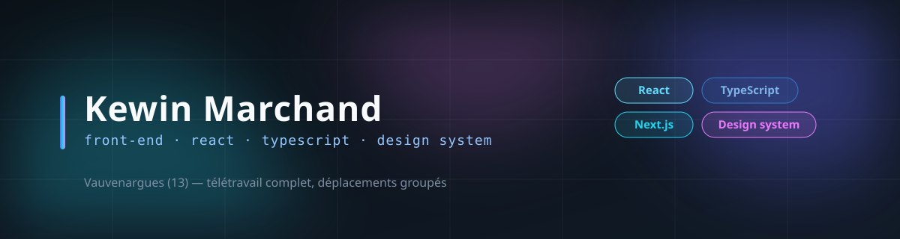
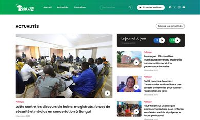

  

> Huit ans de front-end en React et TypeScript, dont trois comme référent front-end. Mon terrain : des applications que les équipes peuvent faire évoluer sans casse — design system, revue de code, tests end-to-end.

## 🚀 Mes réalisations professionnelles

  

<h3 align="center">retail-renault-group.fr</h3>

  Reprise d'un site Angular.js porté en React puis Next.js, maintenu et enrichi au quotidien pendant 8 ans. Travail avec graphiste, product owner, chef de projet. Rôle de garant / référent front / standards digitaux. Mise en place des push GTM à grande échelle, intégration d'une solution pour le contenu administrable, création des domaines, repositories et services, conception et mise en place de l'architecture. RGAA, SEO, Core Web Vitals, GA4, Sentry, GTM.

<table style="border:none;border-collapse:separate;border-spacing:12px" border="0" cellpadding="8" cellspacing="8">
<tr>
<td align="center" style="border:none"><h3 align="center">spk-group.fr</h3>
Intégrateur / développeur front-end. RGAA, SEO.
</td>
<td align="center" style="border:none"><h3 align="center">datagora.fr</h3>
Intégrateur / développeur. RGAA.
</td>
</tr>
<tr>
<td align="center" style="border:none"><h3 align="center">radioguira.org</h3>
Intégrateur / développeur front-end. RGAA, SEO.
</td>
<td align="center" style="border:none"><h3 align="center">oreca-experiences.com</h3>
Intégrateur / développeur front-end. SEO.
</td>
</tr>
</table>

<table style="border:none;border-collapse:separate;border-spacing:12px" border="0" cellpadding="8" cellspacing="8">
<tr>
<td align="center" style="border:none"><h3 align="center">dhlexpress.fr</h3>
Intégrateur / développeur front-end. RGAA, GA4, Sentry, GTM.
</td>
<td align="center" style="border:none"><h3 align="center">aa-biomasse.com</h3>
Intégrateur / développeur front-end. SEO.
</td>
<td align="center" style="border:none"><h3 align="center">jantes-et-pneus.com</h3>
Intégrateur / développeur front-end. SEO.
</td>
</tr>
<tr>
<td align="center" style="border:none"><h3 align="center">quartierdesjantes.com</h3>
Intégrateur / développeur front-end. SEO.
</td>
<td align="center" style="border:none"><h3 align="center">depamoto.com</h3>
Intégrateur / développeur front-end. SEO.
</td>
<td align="center" style="border:none"><h3 align="center">comites-feux.com</h3>
Intégrateur / développeur front-end. RGAA.
</td>
</tr>
</table>

<b>📋 Détail des réalisations</b>

&nbsp;

### 🚗 Plateforme e-commerce automobile à fort trafic
*Retail Renault Group (RRG), réseau multi-concessions*

**Auteur principal de la refonte**, de l'ancienne application Angular à Next.js. Refonte complète : domaines indépendants, design system, rendu serveur, tunnel d’achat, SEO, accessibilité, scénarios e2e, Core Web Vitals.
Des domaines indépendants, un design system d'une quarantaine de composants, un thème multi-marques, plus de deux cents scénarios end-to-end. Plus de 6 500 heures sur les sites du groupe depuis 2018.

`Next.js` `React` `TypeScript` `Redux Toolkit` `TanStack Query` `MUI` `CodeceptJS`

### 🛍️ Portails de commande B2B
*Sur Djust · distribution professionnelle et grande consommation*

Sur la solution B2B Djust : **une dizaine de déclinaisons clientes d’une même base**, avec catalogues, comptes multi-acheteurs, circuits de commande et back-offices. Front en Nuxt 2 et TypeScript, composants documentés dans Storybook. Plus de 850 heures sur ces portails depuis 2022.

`Nuxt 2` `TypeScript` `Storybook`

### 📦 Refonte du site DHL Express France
*DHL Express, transport express international*

Refonte graphique complète du front, site maintenu dans la durée et audité au regard du RGAA. Plan de mesure GA4 et son contrôle qualité.

`Symfony` `Laravel` `JavaScript` `GA4`

**Autres réalisations**

- **aa-biomasse** : site vitrine. `React` `Next.js`
- **Jantes et Pneus** : boutique e-commerce et configurateur de compatibilité véhicule. `Symfony` `Twig` `Vue.js`
- **Quartier des Jantes** : boutique e-commerce et configurateur de compatibilité véhicule. `Symfony` `Twig` `Vue.js`
- **Dépamoto** : boutique e-commerce de pièces moto. `Symfony` `Twig` `Vue.js`
- **AD13** : site vitrine associatif. `React` `React admin`
- **Datagora** : média de vulgarisation statistique, site web et application mobile sur le Play Store. `React` `React Native`
- **Radio Guira** : site radio (Symfony, SPA React, lecteur audio, RGAA). `Symfony` `React` `TypeScript`
- **Oreca Experience** : sites d'Oreca Events et du Driving Center. `Next.js` `Framer Motion`
- **Audits d'accessibilité RGAA 4.1** : Monext, solutions de paiement (taux de conformité mesuré, non-conformités relevées, plan de remédiation chiffré en jours, puis mise en conformité) et trois audits plus ciblés. `RGAA 4.1` `WCAG 2.1 AA`
- **E-commerce de pièces auto et moto** (Dépamoto, Quartier des Jantes, Jantes et Pneus) : boutiques et configurateur de compatibilité véhicule, maintenu plusieurs années. `Symfony` `Twig` `Vue.js`
- **Applications métier** : plateforme de recrutement Jobs by RRG, application tablette d'audits terrain pour Montaclair, utilisable hors ligne. `Vue.js` `Twig`
- **Une vingtaine de sites vitrines et institutionnels**, plusieurs multilingues. `React` `Next.js` `Vue.js` `Svelte` `WordPress`

## 🛠️ Mes dépôts test

<table border="0" cellpadding="8" cellspacing="8">
<tr>
<td align="center" width="50%" style="border:none"><h3 align="center">Laboratoire machine learning</h3>
Intégrateur / développeur front-end.
</td>
<td align="center" width="50%" style="border:none"><h3 align="center">Pause café</h3>
Intégrateur / développeur front-end.
</td>
</tr>
</table>

<b>🧰 Compétences</b>

&nbsp;

| Domaine | Ce que je pratique |
|---|---|
| **Front-end** | React, Next.js (App Router, Server Components), TypeScript, Redux Toolkit, TanStack Query, Vue 3 et Nuxt, Svelte |
| **Interface** | MUI, Tailwind, Sass, Storybook, Framer Motion, intégration fidèle aux maquettes Figma |
| **Qualité** | Revue de code, tests end-to-end (CodeceptJS, Playwright), Core Web Vitals, Lighthouse, checklist de mise en production |
| **Accessibilité** | RGAA 4.1 et WCAG 2.1 AA au quotidien, audits |
| **Back consommé** | API REST, Symfony et API Platform, types générés depuis OpenAPI, Node.js |
| **Outillage** | Git, GitHub, GitLab, Docker, Sentry, GA4, Matomo |
| **IA** | Claude Code au quotidien : contexte projet versionné, agents de développement, de relecture et de recette, hooks de contrôle avant commit |

Ce que je ne fais pas : modélisation de bases de données, administration système, développement back-end.

<b>💼 Parcours</b>

&nbsp;

<table>
<tr><th width="22%" style="white-space:nowrap">Période</th><th width="38%">Poste</th><th width="40%">Structure</th></tr>
<tr><td style="white-space:nowrap">2018 &rarr; 2026</td><td><b>Développeur front-end et référent front-end</b></td><td>PURJUS Communication, agence digitale</td></tr>
<tr><td style="white-space:nowrap">2017 &rarr; 2018</td><td><b>Formateur « Web designer »</b></td><td>AFPA</td></tr>
<tr><td style="white-space:nowrap">2017</td><td><b>Intégrateur web</b></td><td>Agence Hors Pistes</td></tr>
<tr><td style="white-space:nowrap">2015 &rarr; 2017</td><td><b>Infographiste paysager</b></td><td>Star's Jardin, Thibaud de Beschart</td></tr>
<tr><td style="white-space:nowrap">2015</td><td>Vendeur conseil jardinerie</td><td>Botanic</td></tr>
<tr><td style="white-space:nowrap">2010 &rarr; 2013</td><td>Ouvrier paysagiste</td><td>Les Jardins Sestian</td></tr>
<tr><td style="white-space:nowrap">2005 &rarr; 2010</td><td>Jardinier-paysagiste</td><td>Particuliers employeurs (CESU)</td></tr>
<tr><td style="white-space:nowrap">1999 &rarr; 2005</td><td>Apprenti paysagiste, du BEPA au BTSA</td><td>Jardin Vert</td></tr>
</table>

2005 : Prix de l'apprentissage Midi-Pyrénées.

<b>🎓 Formation</b>

&nbsp;

<table>
<tr><th width="22%" style="white-space:nowrap">Période</th><th width="50%">Formation</th><th width="28%">Structure</th></tr>
<tr><td style="white-space:nowrap">2017 &rarr; 2018</td><td>Titre professionnel <b>Designer web</b> (niveau 5)</td><td>AFPA</td></tr>
<tr><td style="white-space:nowrap">2014</td><td><b>DAO — Professionnaliser sa pratique</b> (AutoCAD, SketchUp, SolidWorks)</td><td>GRETA Occitanie</td></tr>
<tr><td style="white-space:nowrap">2003 &rarr; 2005</td><td>BTSA Aménagement de l'espace paysager</td><td>CFPPA Auzeville-Tolosane</td></tr>
</table>

<b>📌 Autres</b>

&nbsp;

- Permis B
- Français (langue maternelle)
- Anglais (lecture technique)
- Espagnol (intermédiaire)
- Passionné de botanique

  
  
  

Passionné de botanique
