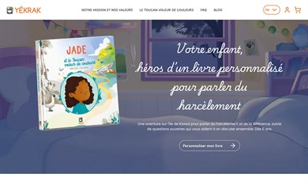
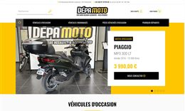
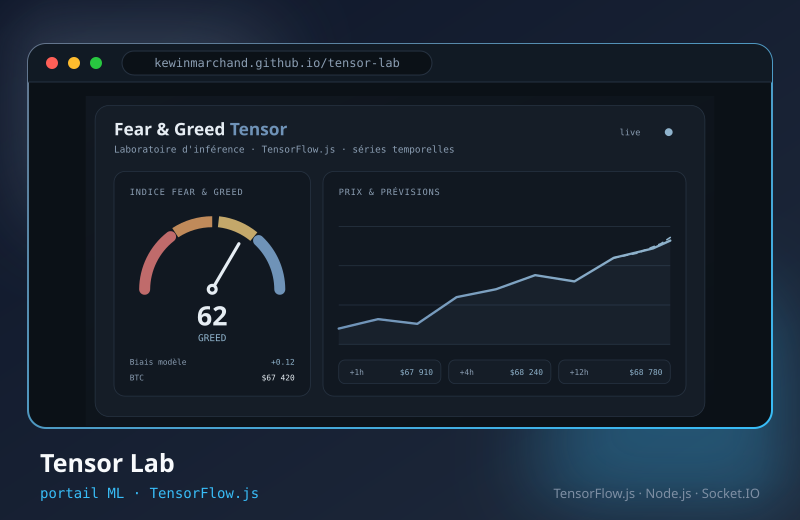

  

> Huit ans de front-end en React et TypeScript, dont trois comme référent front-end. Mon terrain : des applications que les équipes peuvent faire évoluer sans casse — design system, revue de code, tests end-to-end.

> **♿ Accessibilité numérique (RGAA)**  
> Référent sur les sujets d’accessibilité, j’ai notamment été en charge de l’audit de solutions bancaires, puis de leur remédiation — en direct dans le code ou en tant qu’expert et force de proposition auprès des équipes. De façon générale, sur l’ensemble des projets, j’accorde une attention particulière à l’accessibilité (RGAA/WCAG), de la conception à la mise en conformité.

## ✦ Mes réalisations professionnelles

  

<h3 align="center">retail-renault-group.fr</h3>

<strong>Plateforme e-commerce et de services automobile</strong>

  Réseau Retail Renault Group (Renault, Dacia, Alpine) : reprise d’une application existante, refonte complète puis huit années d’évolution continue. Conception et maintien de l’architecture front, du design system, des parcours de stock, de réservation, d’après-vente et de recrutement, avec des exigences fortes en référencement, accessibilité, performance, mesure d’audience et qualité logicielle.

<table style="border:none;border-collapse:separate;border-spacing:12px;table-layout:fixed;width:100%" border="0" cellpadding="8" cellspacing="8">
<tr>
<td align="center" valign="top" width="50%" style="border:none;width:50%"><h3 align="center">dhlexpress.fr</h3>
<strong>Site de commande et d’expédition en ligne</strong>

DHL Express France : refonte graphique complète des parcours de devis, d’envoi, de paiement, de suivi et de compte, avec correctifs suite aux audits de sécurité, améliorations d’accessibilité et suivi de la mesure d’audience.
</td>
<td align="center" valign="top" width="50%" style="border:none;width:50%"><h3 align="center">datagora.fr</h3>
<strong>Site média et application mobile de données publiques</strong>

Développement et évolution du front du site média et de l’application mobile Datagora, dédiés à la mise en récit des données statistiques (rubriques, articles, pages équipe et contact) autour d’un socle de contenus commun, pour rendre l’information plus lisible et engageante.
</td>
</tr>
<tr>
<td align="center" valign="top" width="50%" style="border:none;width:50%"><h3 align="center">pharmaspaces.com</h3>
<strong>Place de marché B2B pharmaceutique</strong>

Projet Djust parmi plusieurs autres réalisations sur la plateforme : parcours de présentation et d’accès, comptes clients et vendeurs, recherche et consultation des produits, demandes de devis et suivi des opérations pour les professionnels du secteur pharmaceutique.
</td>
<td align="center" valign="top" width="50%" style="border:none;width:50%"><h3 align="center">yekrak.com</h3>
<strong>Site e-commerce de livres personnalisés</strong>

Création et vente de livres personnalisés pour enfants, avec un système de configuration interactive du livre (personnalisation du personnage, aperçu), commande et paiement en ligne, dans un parcours multilingue pensé pour les familles.
</td>
</tr>
</table>

<b>📂 Autres réalisations professionnelles</b>

&nbsp;

<table style="border:none;border-collapse:separate;border-spacing:12px;table-layout:fixed;width:100%" border="0" cellpadding="8" cellspacing="8">
<tr>
<td align="center" valign="top" width="50%" style="border:none;width:50%"><h3 align="center">oreca-experiences.com</h3>
<strong>Site expérientiel premium</strong>

Groupe ORECA, expériences de pilotage au Circuit Paul Ricard : création du front avec mises en page immersives, transitions et animations soignées pour valoriser l’univers automobile et les offres d’événements.
</td>
<td align="center" valign="top" width="50%" style="border:none;width:50%"><h3 align="center">spk-group.fr</h3>
<strong>Site vitrine bilingue d’agence</strong>

SPK, agence et médias 100&nbsp;% sport : création complète du site, de la mise en page aux contenus dynamiques, avec pages expertises, projets, recrutement et formulaires. Un soin particulier a été porté aux animations, au rythme éditorial et à l’adaptation sur tous les écrans.
</td>
</tr>
<tr>
<td align="center" valign="top" width="50%" style="border:none;width:50%"><h3 align="center">quartierdesjantes.com</h3>
<strong>Site e-commerce de jantes et pneus</strong>

Maintenance applicative et évolutions fonctionnelles de la boutique (recherche, catalogue, panier, contenus), pour fiabiliser le catalogue et accompagner les opérations courantes.
</td>
<td align="center" valign="top" width="50%" style="border:none;width:50%"><h3 align="center">radioguira.org</h3>
<strong>Site de webradio et d’actualités</strong>

Radio Guira (radio de la MINUSCA en République centrafricaine) : application web avec lecteur audio persistant, actualités, émissions et podcasts, pensée pour offrir une écoute continue et une navigation fluide.
</td>
</tr>
<tr>
<td align="center" valign="top" width="50%" style="border:none;width:50%"><h3 align="center">aa-biomasse.com</h3>
<strong>Site vitrine industriel bilingue</strong>

AA-biomasse, convoyage et stockage de biomasse : développement de A à Z du front relié à un espace d’administration, avec présentation des solutions, réalisations, actualités et formulaires de contact pour mettre en valeur un catalogue technique.
</td>
<td align="center" valign="top" width="50%" style="border:none;width:50%"><h3 align="center">jantes-et-pneus.com</h3>
<strong>Site e-commerce de jantes et pneus</strong>

Développement du parcours de vente, du configurateur de compatibilité véhicule aux fiches produits, packs et tunnel d’achat, en soutien des besoins de conseil et de conversion.
</td>
</tr>
<tr>
<td align="center" valign="top" width="50%" style="border:none;width:50%"><h3 align="center">depamoto.com</h3>
<strong>Site e-commerce de motos et pièces d’occasion</strong>

Maintenance et enrichissements du parcours d’achat (véhicules, pièces détachées, recherche, commande), afin de garder un catalogue vivant et des parcours clairs pour des produits techniques.
</td>
<td align="center" valign="top" width="50%" style="border:none;width:50%"><h3 align="center">comites-feux.com</h3>
<strong>Site institutionnel associatif</strong>

Comités communaux feux de forêts des Bouches-du-Rhône (AD13) : développement front de A à Z (actualités, formations, espace adhérents, documents), avec un espace d’administration dédié pour faciliter l’information du public et la gestion des bénévoles.
</td>
</tr>
</table>

## 🧪 Mes dépôts test

<table border="0" cellpadding="8" cellspacing="8">
<tr>
<td align="center" width="50%" style="border:none"><h3 align="center">Laboratoire machine learning</h3></td>
<td align="center" width="50%" style="border:none"><h3 align="center">Pause café</h3></td>
</tr>
</table>

<b>🛠️ Compétences</b>

&nbsp;

| Domaine | Ce que je pratique |
|---|---|
| **Front-end** | React, Next.js (App Router, Server Components), TypeScript, Redux Toolkit, TanStack Query, Vue 3 et Nuxt, Svelte |
| **Interface** | MUI, Tailwind, Sass, Storybook, Framer Motion, intégration fidèle aux maquettes Figma |
| **Qualité** | Revue de code, tests end-to-end (CodeceptJS, Playwright), Core Web Vitals, Lighthouse, checklist de mise en production |
| **Accessibilité** | RGAA 4.1 et WCAG 2.1 AA au quotidien, audits |
| **Back consommé** | API REST, Symfony et API Platform, types générés depuis OpenAPI, Node.js |
| **Outillage** | Git, GitHub, GitLab, Docker, Sentry, GA4, Matomo |
| **IA** | Claude Code au quotidien : contexte projet versionné, agents de développement, de relecture et de recette, hooks de contrôle avant commit |

Ce que je ne fais pas : modélisation de bases de données, administration système, développement back-end.

<b>👤 Parcours</b>

&nbsp;

<table>
<tr><th width="22%" style="white-space:nowrap">Période</th><th width="38%">Poste</th><th width="40%">Structure</th></tr>
<tr><td style="white-space:nowrap">2018 &rarr; 2026</td><td><b>Développeur front-end et référent front-end</b></td><td>PURJUS Communication, agence digitale</td></tr>
<tr><td style="white-space:nowrap">2017 &rarr; 2018</td><td><b>Formateur « Web designer »</b></td><td>AFPA</td></tr>
<tr><td style="white-space:nowrap">2017</td><td><b>Intégrateur web</b></td><td>Agence Hors Pistes</td></tr>
<tr><td style="white-space:nowrap">2015 &rarr; 2017</td><td><b>Infographiste paysager</b></td><td>Star's Jardin, Thibaud de Beschart</td></tr>
<tr><td style="white-space:nowrap">2015</td><td>Vendeur conseil jardinerie</td><td>Botanic</td></tr>
<tr><td style="white-space:nowrap">2010 &rarr; 2013</td><td>Ouvrier paysagiste</td><td>Les Jardins Sestian</td></tr>
<tr><td style="white-space:nowrap">2005 &rarr; 2010</td><td>Jardinier-paysagiste</td><td>Particuliers employeurs (CESU)</td></tr>
<tr><td style="white-space:nowrap">1999 &rarr; 2005</td><td>Apprenti paysagiste, du BEPA au BTSA</td><td>Jardin Vert</td></tr>
</table>

2005 : Prix de l'apprentissage Midi-Pyrénées.

<b>🎓 Formation</b>

&nbsp;

<table>
<tr><th width="22%" style="white-space:nowrap">Période</th><th width="50%">Formation</th><th width="28%">Structure</th></tr>
<tr><td style="white-space:nowrap">2017 &rarr; 2018</td><td>Titre professionnel <b>Designer web</b> (niveau 5)</td><td>AFPA</td></tr>
<tr><td style="white-space:nowrap">2014</td><td><b>DAO — Professionnaliser sa pratique</b> (AutoCAD, SketchUp, SolidWorks)</td><td>GRETA Occitanie</td></tr>
<tr><td style="white-space:nowrap">2003 &rarr; 2005</td><td>BTSA Aménagement de l'espace paysager</td><td>CFPPA Auzeville-Tolosane</td></tr>
</table>

<b>🌿 Autres</b>

&nbsp;

- Permis B
- Français (langue maternelle)
- Anglais (lecture technique)
- Espagnol (intermédiaire)
- Passionné de botanique

  
  

Passionné de botanique
