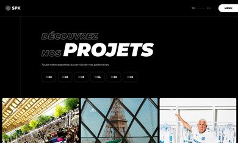
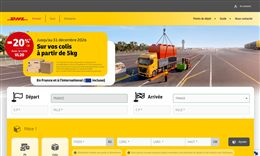
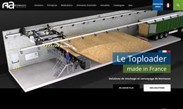
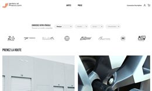
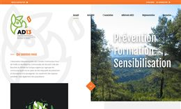
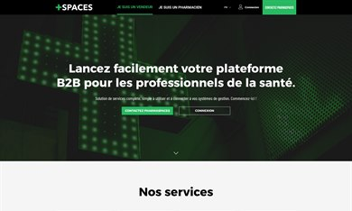

  

> Huit ans de front-end en React et TypeScript, dont trois comme référent front-end. Mon terrain : des applications que les équipes peuvent faire évoluer sans casse — design system, revue de code, tests end-to-end.

## ✦ Mes réalisations professionnelles

  

<h3 align="center">retail-renault-group.fr</h3>

<strong>Plateforme e-commerce et de services automobile</strong>

  <em>👥 chef de projet, product owner, développeurs et équipes métier</em>

  Réseau Retail Renault Group (Renault, Dacia, Alpine) : reprise d’une application existante, refonte complète puis huit années d’évolution continue. Conception et maintien de l’architecture front, du design system, des parcours de stock, de réservation, d’après-vente et de recrutement, avec des exigences fortes en référencement, accessibilité, performance, mesure d’audience et qualité logicielle.

<table style="border:none;border-collapse:separate;border-spacing:12px;table-layout:fixed;width:100%" border="0" cellpadding="8" cellspacing="8">
<tr>
<td align="center" valign="top" width="50%" style="border:none;width:50%"><h3 align="center">spk-group.fr</h3>
<strong>Site vitrine bilingue d’agence</strong>

<em>👥 chef de projet et équipe créative/client</em>

SPK, agence et médias 100&nbsp;% sport : création complète du site, de la mise en page aux contenus dynamiques, avec pages expertises, projets, recrutement et formulaires. Un soin particulier a été porté aux animations, au rythme éditorial et à l’adaptation sur tous les écrans.
</td>
<td align="center" valign="top" width="50%" style="border:none;width:50%"><h3 align="center">datagora.fr</h3>
<strong>Site média et application mobile de données publiques</strong>

<em>👥 chef de projet et équipes éditoriales/produit</em>

Développement et évolution du front du site média et de l’application mobile Datagora, dédiés à la mise en récit des données statistiques (rubriques, articles, pages équipe et contact) autour d’un socle de contenus commun, pour rendre l’information plus lisible et engageante.
</td>
</tr>
<tr>
<td align="center" valign="top" width="50%" style="border:none;width:50%"><h3 align="center">oreca-experiences.com</h3>
<strong>Site expérientiel premium</strong>

<em>👥 chef de projet et équipes créatives/client</em>

Groupe ORECA, expériences de pilotage au Circuit Paul Ricard : création du front avec mises en page immersives, transitions et animations soignées pour valoriser l’univers automobile et les offres d’événements.
</td>
<td align="center" valign="top" width="50%" style="border:none;width:50%"><h3 align="center">dhlexpress.fr</h3>
<strong>Site de commande et d’expédition en ligne</strong>

<em>👥 chef de projet, graphistes interne et externe, équipes techniques et métier</em>

DHL Express France : refonte graphique complète des parcours de devis, d’envoi, de paiement, de suivi et de compte, avec correctifs suite aux audits de sécurité, améliorations d’accessibilité et suivi de la mesure d’audience.
</td>
</tr>
</table>

<b>📂 Autres réalisations professionnelles</b>

&nbsp;

<table style="border:none;border-collapse:separate;border-spacing:12px;table-layout:fixed;width:100%" border="0" cellpadding="8" cellspacing="8">
<tr>
<td align="center" valign="top" width="50%" style="border:none;width:50%"><h3 align="center">radioguira.org</h3>
<strong>Site de webradio et d’actualités</strong>

<em>👥 chef de projet et équipes de la radio</em>

Radio Guira (radio de la MINUSCA en République centrafricaine) : application web avec lecteur audio persistant, actualités, émissions et podcasts, pensée pour offrir une écoute continue et une navigation fluide.
</td>
<td align="center" valign="top" width="50%" style="border:none;width:50%"><h3 align="center">aa-biomasse.com</h3>
<strong>Site vitrine industriel bilingue</strong>

<em>👥 chef de projet et équipes métier du client</em>

AA-biomasse, convoyage et stockage de biomasse : développement de A à Z du front relié à un espace d’administration, avec présentation des solutions, réalisations, actualités et formulaires de contact pour mettre en valeur un catalogue technique.
</td>
</tr>
<tr>
<td align="center" valign="top" width="50%" style="border:none;width:50%"><h3 align="center">jantes-et-pneus.com</h3>
<strong>Site e-commerce de jantes et pneus</strong>

<em>👥 chef de projet et équipes du client, dont les équipes commerciales et vendeuses</em>

Développement du parcours de vente, du configurateur de compatibilité véhicule aux fiches produits, packs et tunnel d’achat, en soutien des besoins de conseil et de conversion.
</td>
<td align="center" valign="top" width="50%" style="border:none;width:50%"><h3 align="center">quartierdesjantes.com</h3>
<strong>Site e-commerce de jantes et pneus</strong>

<em>👥 chef de projet et équipes du client, dont les équipes commerciales et vendeuses</em>

Maintenance applicative et évolutions fonctionnelles de la boutique (recherche, catalogue, panier, contenus), pour fiabiliser le catalogue et accompagner les opérations courantes.
</td>
</tr>
<tr>
<td align="center" valign="top" width="50%" style="border:none;width:50%"><h3 align="center">depamoto.com</h3>
<strong>Site e-commerce de motos et pièces d’occasion</strong>

<em>👥 chef de projet et équipes du client, notamment les équipes commerciales et vendeuses</em>

Maintenance et enrichissements du parcours d’achat (véhicules, pièces détachées, recherche, commande), afin de garder un catalogue vivant et des parcours clairs pour des produits techniques.
</td>
<td align="center" valign="top" width="50%" style="border:none;width:50%"><h3 align="center">comites-feux.com</h3>
<strong>Site institutionnel associatif</strong>

<em>👥 chef de projet et responsables associatifs</em>

Comités communaux feux de forêts des Bouches-du-Rhône (AD13) : développement front de A à Z (actualités, formations, espace adhérents, documents), avec un espace d’administration dédié pour faciliter l’information du public et la gestion des bénévoles.
</td>
</tr>
<tr>
<td align="center" valign="top" width="50%" style="border:none;width:50%"><h3 align="center">Pharmaspace</h3>
<strong>Place de marché B2B pharmaceutique</strong>

<em>👥 chef de projet, équipes produit et client</em>

Réalisation sur la plateforme Djust : parcours de présentation et d’accès, comptes clients et vendeurs, recherche et consultation des produits, demandes de devis et suivi des opérations pour les professionnels du secteur pharmaceutique.
</td>
<td align="center" valign="top" width="50%" style="border:none;width:50%"></td>
</tr>
</table>

<b>📌 Détail des réalisations</b>

&nbsp;

### 🛒 Plateforme e-commerce automobile à fort trafic
*Plateforme e-commerce et de services — Retail Renault Group (RRG), réseau multi-concessions*

<em>👥 chef de projet, product owner, développeurs front/back et équipes métier</em>

**Rôle** : auteur principal de la refonte front, de l’application historique jusqu’à la plateforme actuelle, avec une présence continue sur plus de huit ans.

**Réalisation** : structuration par domaines, design system multi-marques, parcours de recherche/réservation de véhicules (neuf et occasion), après-vente et recrutement, outillage de mesure et d’observabilité. Plus de 200 scénarios de tests automatisés, forte attention portée au référencement, à l’accessibilité, à la performance et à la stabilité des parcours. **Volume** : plus de 6&nbsp;500 heures sur les sites du groupe.

### 🏢 Portails de commande B2B
*Plateformes e-commerce B2B — déclinaisons pour la distribution professionnelle et la grande consommation*

<em>👥 chefs de projet, designers, équipes produit et développeurs</em>

**Rôle** : développeur/intégrateur front-end sur une base commune déclinée pour de nombreux clients.

**Réalisation** : adaptation de catalogues, comptes multi-acheteurs, circuits de commande et interfaces d’administration, avec une bibliothèque de composants documentée et une montée en qualité progressive. Parmi les réalisations présentables : **Pharmaspace**, place de marché B2B pharmaceutique (comptes clients/vendeurs, recherche produit, demandes de devis et suivi). **Volume** : plus de 850 heures sur ces portails depuis 2022.

### 📦 Refonte du site DHL Express France
*Site de commande et d’expédition en ligne — DHL Express, transport express international*

<em>👥 chef de projet, graphistes interne et externe, équipes techniques et métier côté client</em>

**Rôle** : développeur/intégrateur front-end sur la refonte et la maintenance.

**Réalisation** : refonte graphique complète des parcours (devis, expédition, paiement, suivi, compte, points de service), correctifs à la suite d’audits de sécurité, améliorations d’accessibilité et mise en place/suivi de la mesure d’audience.

**Autres réalisations**

- **SPK** — *Site vitrine bilingue d’agence* : création complète du front (contenus, expertises, projets, recrutement) avec animations et attention au rendu responsive. <em>👥 chef de projet et équipe créative/client</em>
- **Datagora** — *Site média et application mobile de données publiques* : développement et évolution du front du site média et de l’application mobile (articles par rubriques, pages éditoriales), en lien avec les enjeux de lisibilité des données. <em>👥 chef de projet et équipes éditoriales/produit</em>
- **Pharmaspace** — *Place de marché B2B pharmaceutique* : contribution aux parcours du portail (accès, comptes clients/vendeurs, recherche produit, demandes de devis et suivi des opérations) sur la plateforme Djust. <em>👥 chef de projet, équipes produit et client</em>
- **Radio Guira** — *Site de webradio et d’actualités* : application web avec lecteur audio persistant, actualités et émissions pour la radio de la MINUSCA en RCA. <em>👥 chef de projet et équipes de la radio</em>
- **Oreca Experiences** — *Site expérientiel premium* : développement du front du site d’expériences de pilotage (Circuit Paul Ricard), avec transitions, animations et optimisation des médias. <em>👥 chef de projet et équipes créatives/client</em>
- **aa-biomasse** — *Site vitrine industriel bilingue* : développement de A à Z du front (solutions, réalisations, actualités, formulaires) connecté à l’administration. <em>👥 chef de projet et équipes métier du client</em>
- **Jantes et Pneus** — *Site e-commerce de jantes et pneus* : création et évolution du front (configurateur véhicule, listings, fiches, packs, tunnel d’achat). <em>👥 chef de projet et équipes du client, dont les équipes commerciales et vendeuses</em>
- **Quartier des Jantes** — *Site e-commerce de jantes et pneus* : maintenance et évolutions fonctionnelles de la boutique (catalogue, recherche, commande), en appui des opérations quotidiennes. <em>👥 chef de projet et équipes du client, dont les équipes commerciales et vendeuses</em>
- **Dépamoto** — *Site e-commerce de motos et pièces d’occasion* : maintenance et enrichissements des parcours véhicules/pièces et du tunnel de commande. <em>👥 chef de projet et équipes du client, dont les équipes commerciales et vendeuses</em>
- **Comités Feux (AD13)** — *Site institutionnel associatif* : développement front de A à Z (actualités, formations, espace adhérents, documents) et intégration avec l’administration. <em>👥 chef de projet et responsables associatifs</em>
- **Audits d’accessibilité RGAA** : notamment pour Monext (solutions de paiement) — mesure du taux de conformité, relevé des non-conformités, plan de remédiation chiffré puis accompagnement de la mise en conformité — ainsi que plusieurs audits ciblés. <em>👥 chefs de projet et équipes produit/techniques des clients</em>
- **Applications métier** : plateforme de recrutement Jobs by RRG et application tablette d’audits terrain pour Montaclair, utilisable hors ligne. <em>👥 chefs de projet et équipes métier</em>
- **Sites vitrines et institutionnels** : une vingtaine de réalisations, dont plusieurs multilingues, aux périmètres et enjeux variés (présentation, acquisition, contenus éditoriaux). <em>👥 chefs de projet, designers et équipes clients selon les projets</em>

## 🧪 Mes dépôts test

<table border="0" cellpadding="8" cellspacing="8">
<tr>
<td align="center" width="50%" style="border:none"><h3 align="center">Laboratoire machine learning</h3></td>
<td align="center" width="50%" style="border:none"><h3 align="center">Pause café</h3></td>
</tr>
</table>

<b>🛠️ Compétences</b>

&nbsp;

| Domaine | Ce que je pratique |
|---|---|
| **Front-end** | React, Next.js (App Router, Server Components), TypeScript, Redux Toolkit, TanStack Query, Vue 3 et Nuxt, Svelte |
| **Interface** | MUI, Tailwind, Sass, Storybook, Framer Motion, intégration fidèle aux maquettes Figma |
| **Qualité** | Revue de code, tests end-to-end (CodeceptJS, Playwright), Core Web Vitals, Lighthouse, checklist de mise en production |
| **Accessibilité** | RGAA 4.1 et WCAG 2.1 AA au quotidien, audits |
| **Back consommé** | API REST, Symfony et API Platform, types générés depuis OpenAPI, Node.js |
| **Outillage** | Git, GitHub, GitLab, Docker, Sentry, GA4, Matomo |
| **IA** | Claude Code au quotidien : contexte projet versionné, agents de développement, de relecture et de recette, hooks de contrôle avant commit |

Ce que je ne fais pas : modélisation de bases de données, administration système, développement back-end.

<b>👤 Parcours</b>

&nbsp;

<table>
<tr><th width="22%" style="white-space:nowrap">Période</th><th width="38%">Poste</th><th width="40%">Structure</th></tr>
<tr><td style="white-space:nowrap">2018 &rarr; 2026</td><td><b>Développeur front-end et référent front-end</b></td><td>PURJUS Communication, agence digitale</td></tr>
<tr><td style="white-space:nowrap">2017 &rarr; 2018</td><td><b>Formateur « Web designer »</b></td><td>AFPA</td></tr>
<tr><td style="white-space:nowrap">2017</td><td><b>Intégrateur web</b></td><td>Agence Hors Pistes</td></tr>
<tr><td style="white-space:nowrap">2015 &rarr; 2017</td><td><b>Infographiste paysager</b></td><td>Star's Jardin, Thibaud de Beschart</td></tr>
<tr><td style="white-space:nowrap">2015</td><td>Vendeur conseil jardinerie</td><td>Botanic</td></tr>
<tr><td style="white-space:nowrap">2010 &rarr; 2013</td><td>Ouvrier paysagiste</td><td>Les Jardins Sestian</td></tr>
<tr><td style="white-space:nowrap">2005 &rarr; 2010</td><td>Jardinier-paysagiste</td><td>Particuliers employeurs (CESU)</td></tr>
<tr><td style="white-space:nowrap">1999 &rarr; 2005</td><td>Apprenti paysagiste, du BEPA au BTSA</td><td>Jardin Vert</td></tr>
</table>

2005 : Prix de l'apprentissage Midi-Pyrénées.

<b>🎓 Formation</b>

&nbsp;

<table>
<tr><th width="22%" style="white-space:nowrap">Période</th><th width="50%">Formation</th><th width="28%">Structure</th></tr>
<tr><td style="white-space:nowrap">2017 &rarr; 2018</td><td>Titre professionnel <b>Designer web</b> (niveau 5)</td><td>AFPA</td></tr>
<tr><td style="white-space:nowrap">2014</td><td><b>DAO — Professionnaliser sa pratique</b> (AutoCAD, SketchUp, SolidWorks)</td><td>GRETA Occitanie</td></tr>
<tr><td style="white-space:nowrap">2003 &rarr; 2005</td><td>BTSA Aménagement de l'espace paysager</td><td>CFPPA Auzeville-Tolosane</td></tr>
</table>

<b>🌿 Autres</b>

&nbsp;

- Permis B
- Français (langue maternelle)
- Anglais (lecture technique)
- Espagnol (intermédiaire)
- Passionné de botanique

  
  

Passionné de botanique
